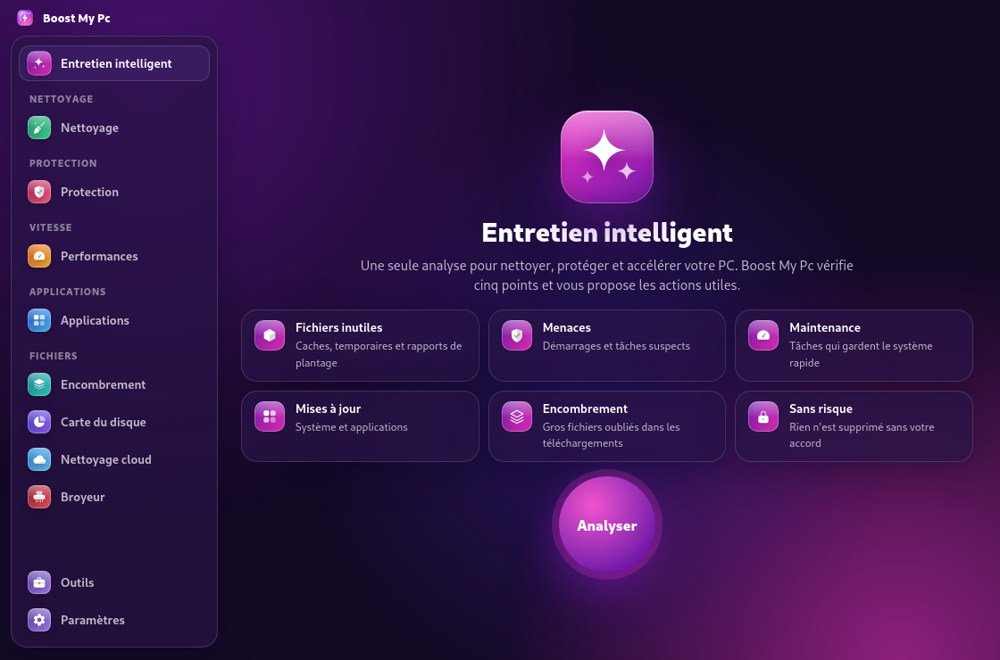
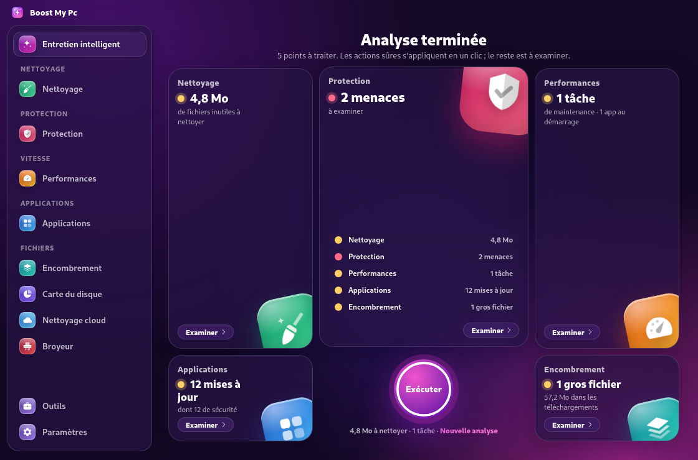
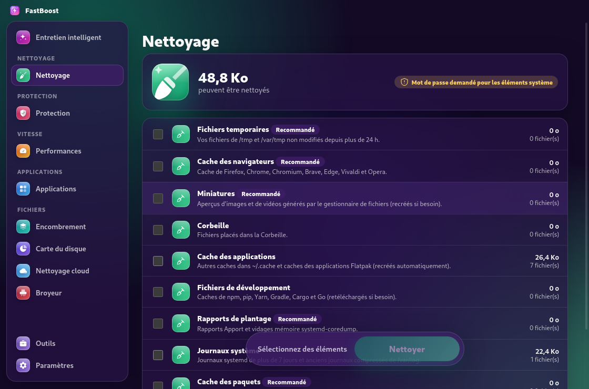
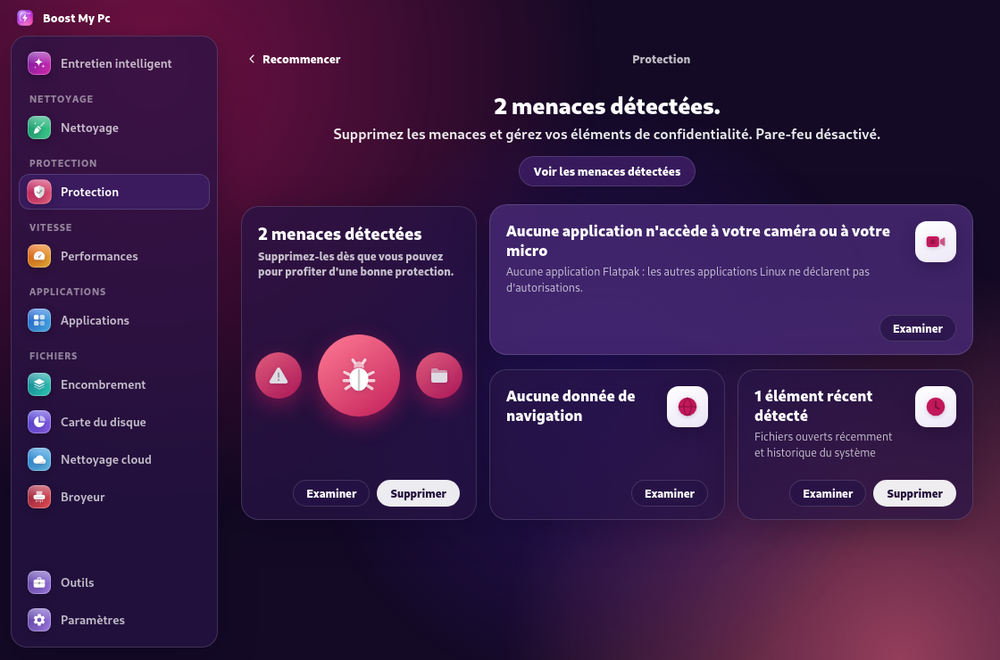
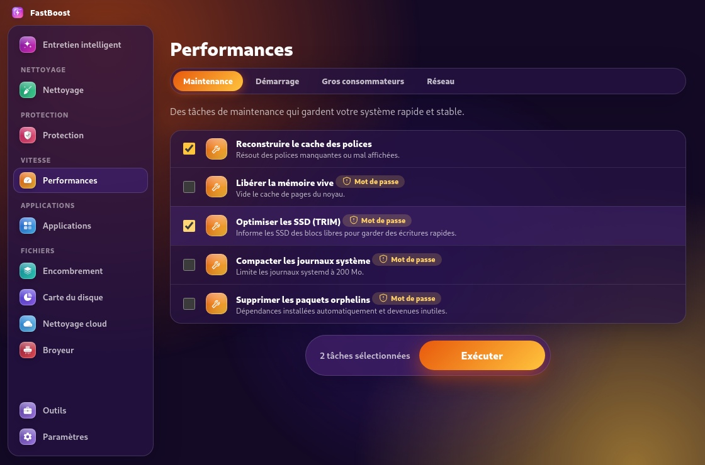
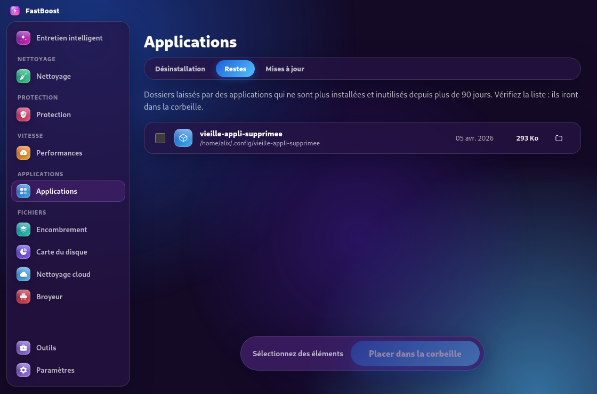
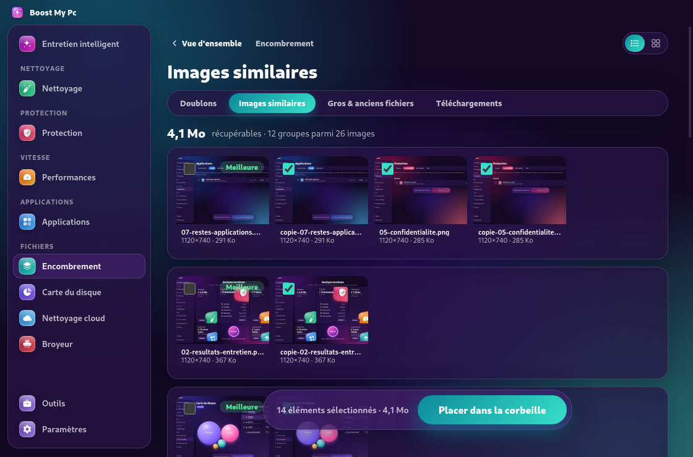
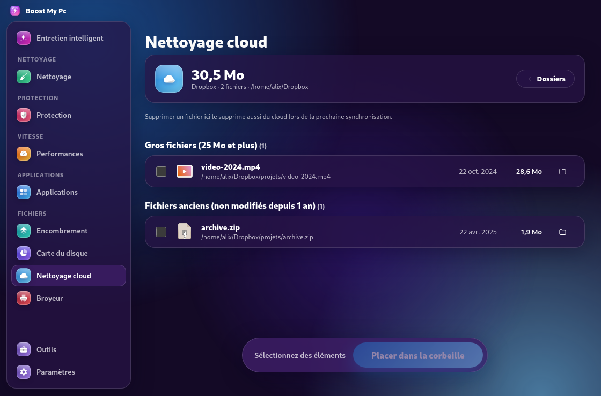
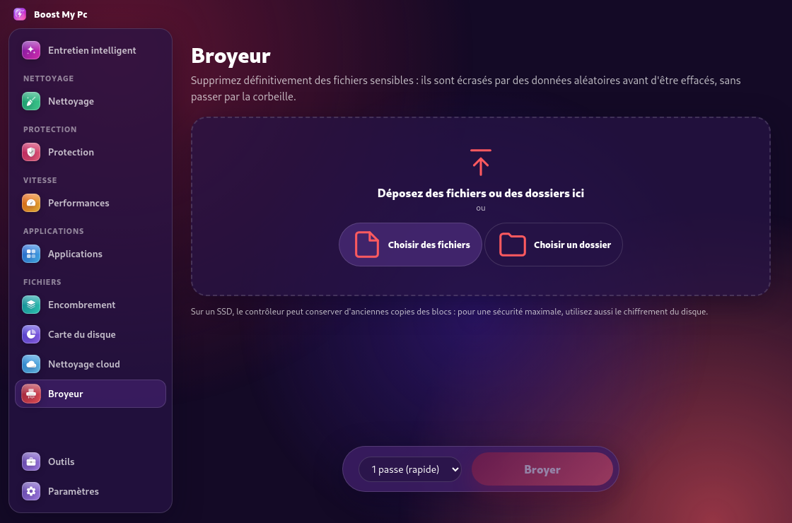
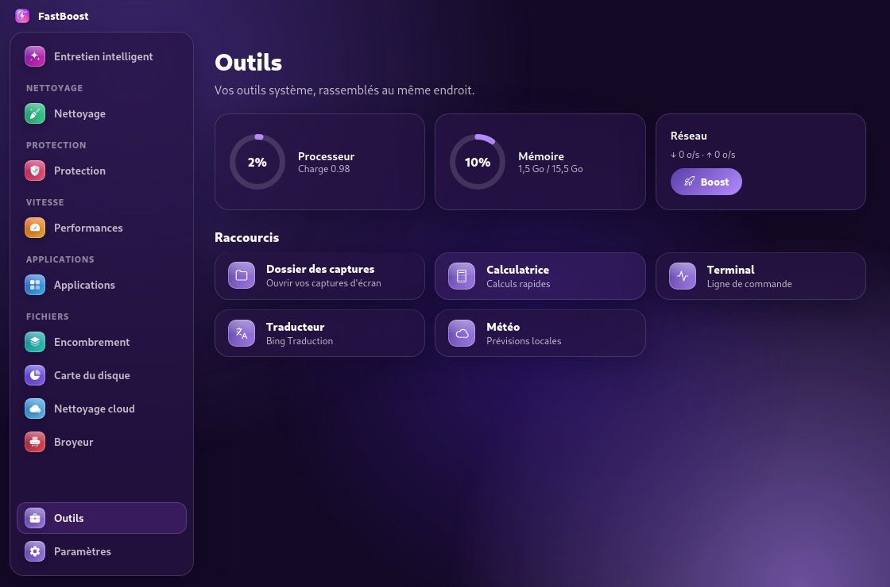

<p align="center">
  
</p>

<h1 align="center">Boost My Pc</h1>

<p align="center"><b>Clean, protect, and speed up your PC — on Linux and Windows.</b></p>

Boost My Pc 2 brings together more than 25 PC maintenance tools, with a distinct color for each module. Its features take inspiration from **CleanMyMac** (modules reviewed with REA; see [docs/ANALYSE-CLEANMYMAC.md](docs/ANALYSE-CLEANMYMAC.md)) and **Microsoft PC Manager** ([docs/ANALYSE-REA.md](docs/ANALYSE-REA.md)). This is an independent project: it reuses no logos, icons, or code from those applications.

<p align="center">
  
</p>

## Screenshots (Linux)

### Smart Care

One scan checks five areas; one click applies safe actions.



| Cleanup | Protection — threats |
|---|---|
|  |  |

| Privacy | Performance |
|---|---|
|  |  |

| App leftovers | Similar images |
|---|---|
|  |  |

| Disk Map | Cloud Cleanup |
|---|---|
|  |  |

| Shredder | Tools | Settings |
|---|---|---|
|  |  |  |

> Screenshots were captured on Debian 12 (Xvfb) with test data; the desktop panel and window controls are not shown.

## Modules

| Module | What it does |
|---|---|
| **Smart Care** | Checks for junk files, threats, maintenance tasks, updates, and large forgotten files in one scan. **Run** applies safe actions. |
| **Cleanup** | Cleans system and browser caches, temporary files, logs, crash reports, package caches, development caches (npm, pip, Yarn, Gradle, Cargo), and the trash. |
| **Protection** | Runs quick, standard, or deep scans (ClamAV with heuristic scanning on Linux; Microsoft Defender on Windows); manages privacy data (history, cookies, sessions — never passwords or bookmarks); checks app permissions (Flatpak on Linux, camera/microphone/location on Windows) and firewall status. |
| **Performance** | Runs maintenance tasks (DNS, fonts, SSD TRIM, logs, orphaned packages, and more), manages startup apps, finds resource-heavy processes, and diagnoses network issues. |
| **Applications** | Uninstalls apps (apt, dnf, pacman, zypper, Flatpak, Snap on Linux; Windows apps and Microsoft Store apps), finds leftovers from removed apps, and checks for updates. |
| **Storage** | Finds exact duplicates, similar images (perceptual hash), large and old files, and downloads. |
| **Disk Map** | Explore folder sizes interactively and remove items you no longer need. |
| **Cloud Cleanup** | Finds large and old files in OneDrive, Dropbox, Google Drive, Nextcloud, and other synced folders. Includes **Free up local space** for OneDrive. |
| **Shredder** | Permanently deletes files by overwriting them with random data (1, 3, or 7 passes). Supports drag and drop. |
| **Mini panel** | On Linux, click the top-bar icon to open a compact panel with system status, Boost, trash, and updates. Run `boost-my-pc --mini` to open it from a keyboard shortcut. |

Nothing is deleted without confirmation. Deletions go through the trash, except when you explicitly use the Shredder. System folders are protected, and Linux system actions request your password through polkit.

## Installation

Download the installers from the [latest release](https://github.com/Finoana-Randri/FastBoost/releases/latest).

### Linux

```bash
# Debian / Ubuntu / Mint / Pop!_OS
sudo apt install ./Boost-My-Pc-2.0.1.deb

# All distributions
chmod +x Boost-My-Pc-2.0.1.AppImage && ./Boost-My-Pc-2.0.1.AppImage
```

On standard GNOME desktops (Fedora, Debian), install the *AppIndicator and KStatusNotifierItem Support* extension to show the top-bar icon.

### Windows

Run `Boost-My-Pc-Setup-2.0.1.exe` from the latest release.

### From source

```bash
npm install
npm start
```

### Build packages

```bash
npm run dist:linux   # AppImage + .deb
npm run dist:win     # Windows installer
```

## Performance

Boost My Pc automatically switches to lightweight mode on systems without graphics acceleration, such as virtual machines. You can change this in **Settings → Visual Effects** (Automatic, On, or Off). The app follows the system's light or dark theme.

## Tests

```bash
node scripts/test-v2-services.js      # v2 modules (Windows or Linux)
npm run test:linux                    # Core Linux services
```

With Docker, run `scripts/docker-test.sh` (Debian 12, Fedora 41, Arch Linux) or `scripts/docker-v2.sh` (v2 services and 16 UI flows under Xvfb with test data).

## Project structure

```
src/main.js                 Main process, IPC, lightweight mode
src/menubar.js              Top-bar icon, mini panel, alerts
src/services/               Windows (PowerShell), Linux (src/services/linux), and shared services
src/services/v2/            v2 modules: Smart Care, maintenance, privacy, permissions,
                            leftovers, threats, shredder, Disk Map, similar images, cloud
src/renderer/               App interface and mini panel
assets/                     App and tray icons
scripts/                    Tests and Docker builds
docs/                       REA analyses and screenshots
```

## License

MIT. Independent project, not affiliated with Microsoft or MacPaw.
