# FastBoost

**Optimisez, nettoyez et protégez votre PC — sous Linux et Windows.**

FastBoost est une application Electron inspirée de **Microsoft PC Manager** (dont les fonctionnalités ont été analysées par rétro-ingénierie avec REA, voir [docs/ANALYSE-REA.md](docs/ANALYSE-REA.md)) et du mini-panneau de **CleanMyMac X**. Sous Linux, elle adopte le style GNOME / libadwaita et s'intègre à la barre supérieure.

<p align="center">
  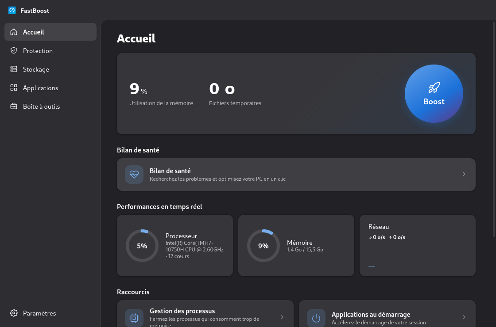
</p>

## Captures d'écran (Linux)

### Mini-panneau dans la barre supérieure

Comme CleanMyMac X dans la barre des menus de macOS : un clic sur l'icône FastBoost de la barre supérieure ouvre ce panneau juste en dessous.

<p align="center">
  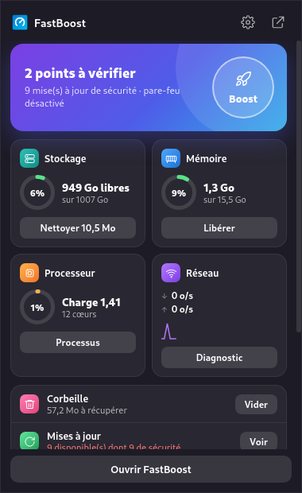
  &nbsp;&nbsp;
  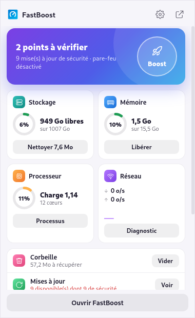
</p>

### Application

| Accueil (clair) | Bilan de santé |
|---|---|
| 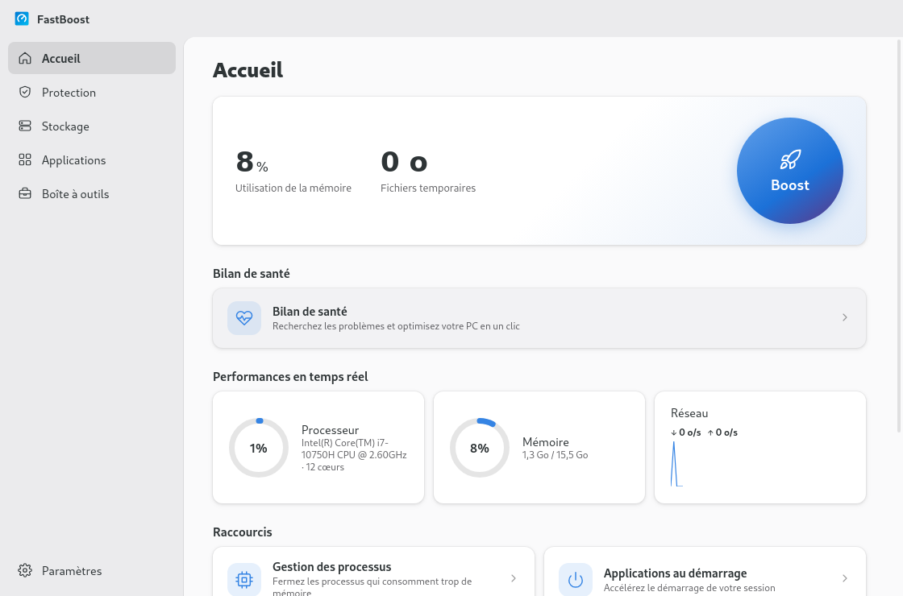 | 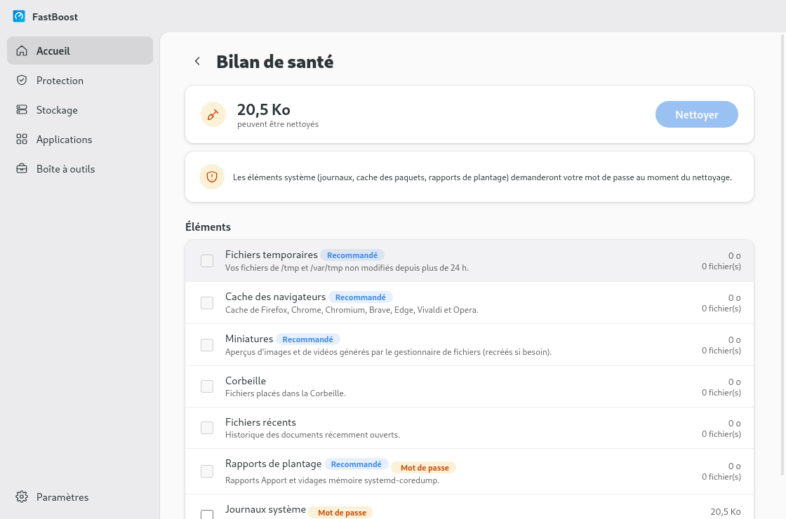 |

| Stockage | Applications installées |
|---|---|
| 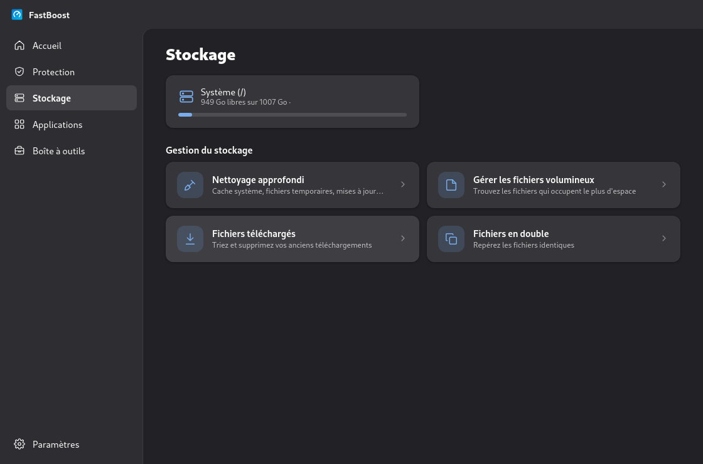 | 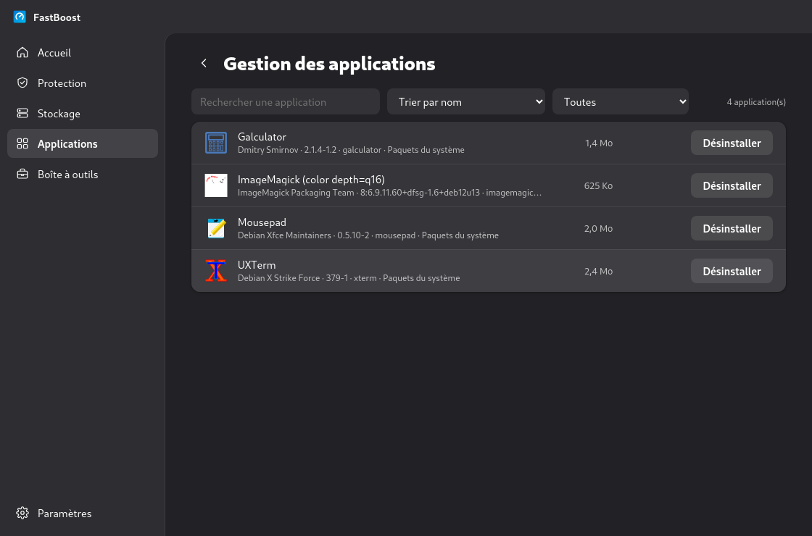 |

| Processus | Applications au démarrage |
|---|---|
| 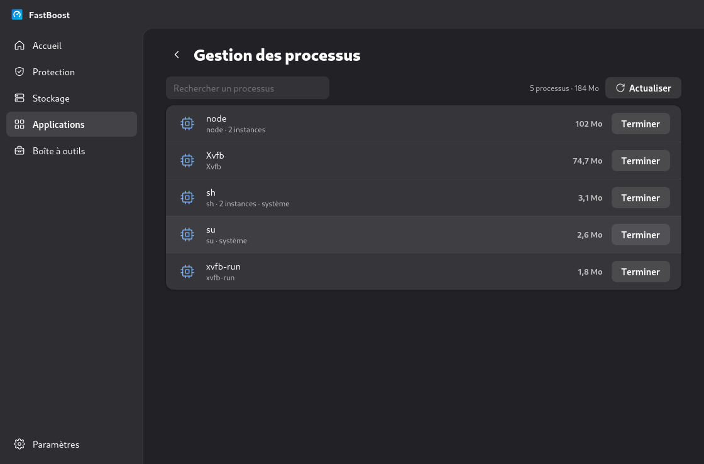 | 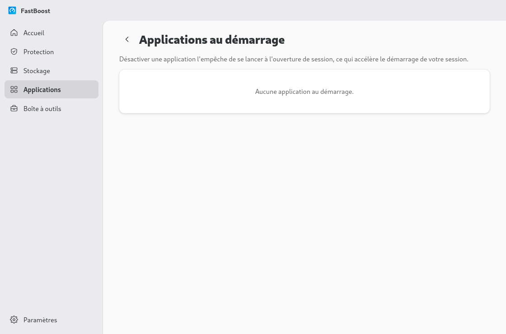 |

| Protection | Mises à jour du système |
|---|---|
| 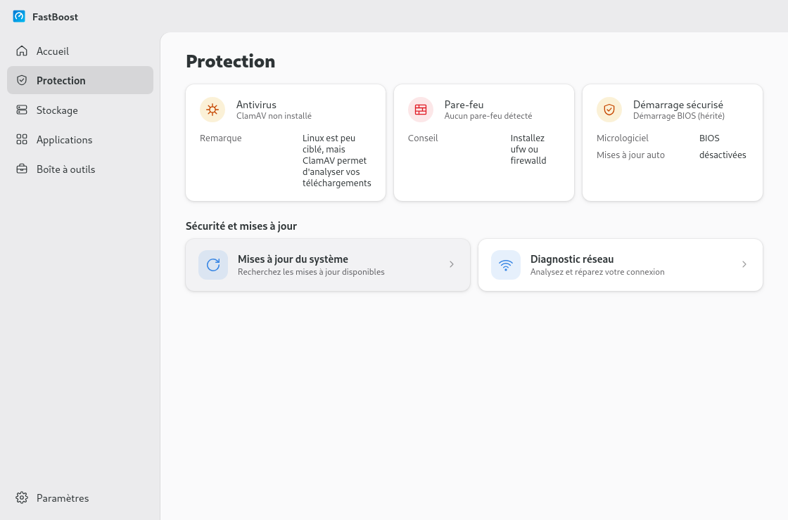 | 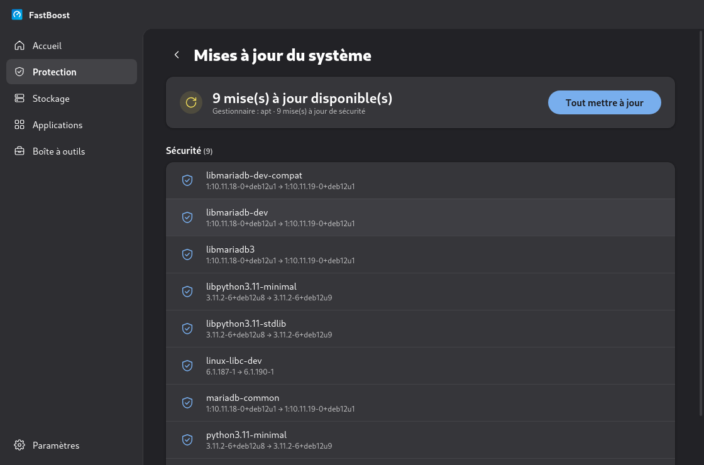 |

| Diagnostic réseau | Boîte à outils |
|---|---|
| 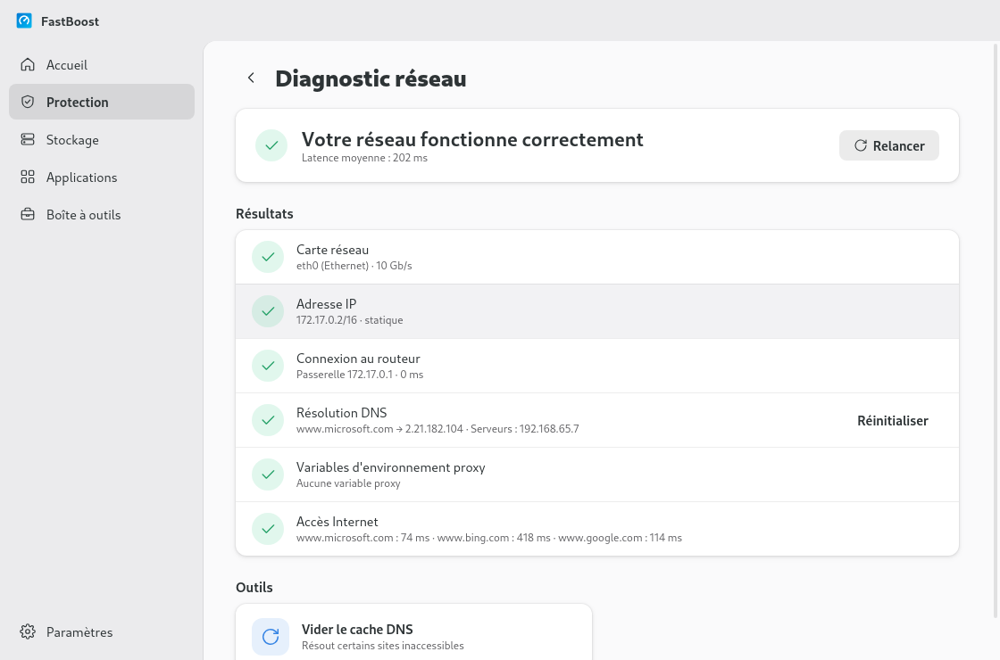 | 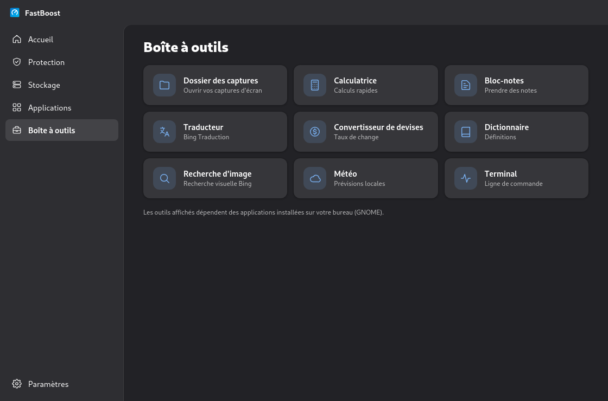 |

| Paramètres |
|---|
| 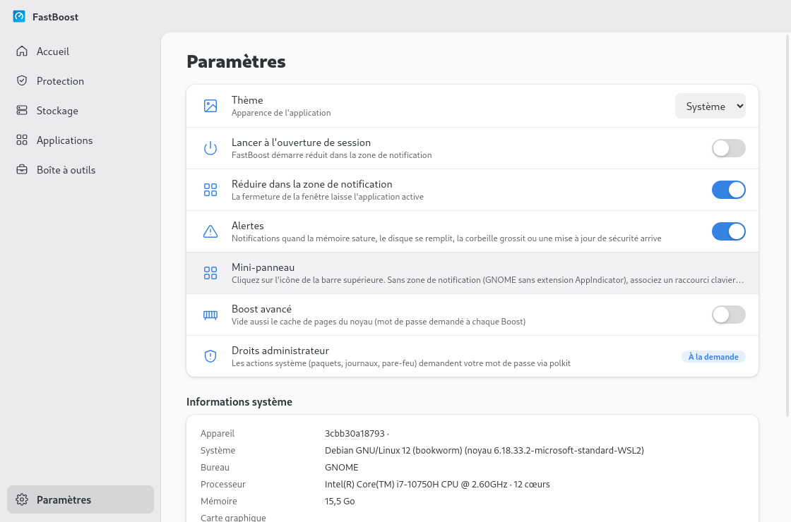 |

> Captures réalisées dans Debian 12 (Xvfb) ; les boutons de fenêtre et la barre du bureau n'y apparaissent donc pas.

## Installation

### Linux

```bash
# Debian / Ubuntu / Mint / Pop!_OS
sudo apt install ./fastboost_1.2.0_amd64.deb

# Toutes les distributions
chmod +x FastBoost-1.2.0.AppImage && ./FastBoost-1.2.0.AppImage
```

### Depuis les sources (Linux ou Windows)

```bash
npm install
npm start
```

### Construire les paquets

```bash
npm run dist:linux   # AppImage + .deb (sous Linux)
npm run dist:win     # installateur Windows
```

Depuis Windows, les paquets Linux se construisent avec Docker :

```bash
docker run --rm -v "$PWD:/src:ro" -v "$PWD/dist:/out" electronuserland/builder:20 sh /src/scripts/docker-build-linux.sh
```

## Le mini-panneau

- état général (« Votre PC est en forme » ou les points à vérifier) et bouton **Boost** ;
- **Stockage** (espace libre, *Nettoyer*), **Mémoire** (*Libérer*), **Processeur** (charge), **Réseau** (débits en direct) ;
- **Corbeille** (*Vider*, avec confirmation), **Mises à jour**, **Pare-feu** ;
- les 3 plus gros consommateurs de mémoire, avec *Quitter* (fermeture propre, avec confirmation).

Il se ferme quand on clique ailleurs ou avec Échap. L'infobulle de l'icône affiche le processeur, la mémoire et le réseau en temps réel, et des **alertes** (désactivables) préviennent quand la mémoire sature, que le disque se remplit, que la corbeille dépasse 1 Go ou qu'une mise à jour de sécurité est disponible.

| Bureau | Icône dans la barre |
|---|---|
| Ubuntu, Zorin, Pop!_OS | Oui (extension AppIndicator incluse) |
| GNOME « pur » (Fedora, Debian…) | Installer l'extension **AppIndicator and KStatusNotifierItem Support** |
| KDE Plasma, Xfce, Cinnamon, MATE, Budgie | Oui (zone de notification native) |

Sans icône, associez un raccourci clavier à `fastboost --mini` (Paramètres → Clavier → Raccourcis personnalisés) : il ouvre et ferme le panneau.

## Fonctionnalités

| Section | Linux | Windows |
|---|---|---|
| Boost | Synchronisation des disques (+ vidage du cache noyau en option) + fichiers temporaires | Vidage des working sets + fichiers temporaires |
| Nettoyage | /tmp, caches navigateurs (y compris Flatpak/Snap), miniatures, corbeille, ~/.cache, rapports de plantage, journaux systemd, cache des paquets, runtimes Flatpak inutilisés | Temp, caches navigateurs, WER, dumps, miniatures, DirectX, Windows Update, Corbeille |
| Stockage | Fichiers volumineux, téléchargements, doublons | Idem |
| Processus | /proc, noms et icônes des applications, fermeture propre | Get-Process |
| Démarrage | Fichiers XDG autostart | Registre Run + StartupApproved |
| Désinstallation | apt / dnf / pacman / zypper, Flatpak, Snap | Registre + Microsoft Store |
| Protection | ClamAV, ufw / firewalld, Secure Boot, mises à jour automatiques | Defender, pare-feu, protection contre la falsification |
| Mises à jour | apt / dnf / pacman / zypper + Flatpak + Snap, installation en un clic | Windows Update |
| Réseau | ip, NetworkManager, resolvectl, proxy GNOME | DNS, IP, passerelle, proxy, Winsock |
| Boîte à outils | Outils détectés sur votre bureau (GNOME, KDE, Xfce…) | Applications Windows |

Sous Linux, les actions système (paquets, journaux, pare-feu) demandent le mot de passe via **polkit (pkexec)**, une seule fois par opération. FastBoost ne s'affiche pas dans ses propres listes et refuse de terminer les processus système essentiels.

## Tests

```bash
npm run test:linux
```

Les services Linux sont testés dans Docker sur **Debian 12, Fedora 41 et Arch Linux** (`scripts/docker-test.sh`), l'interface et le mini-panneau sous Xvfb (`scripts/docker-gui.sh`, `scripts/docker-mini.sh`), et le paquet `.deb` installé dans un Debian vierge (`scripts/docker-test-deb.sh`).

## Structure

```
src/main.js                 processus principal, IPC
src/menubar.js              icône de la barre supérieure, mini-panneau, alertes
src/preload.js              API exposée à l'interface (window.pcm)
src/services/index.js       choisit l'implémentation selon l'OS
src/services/*.js           Windows (PowerShell) + stockage et outils communs
src/services/linux/*.js     Linux (/proc, XDG, gestionnaires de paquets, polkit)
src/renderer/               interface (thèmes Adwaita et Fluent) + mini-panneau
scripts/                    tests et construction Linux via Docker
docs/                       analyse REA et captures d'écran
```

## Licence

MIT. Projet indépendant, non affilié à Microsoft ni à MacPaw.
